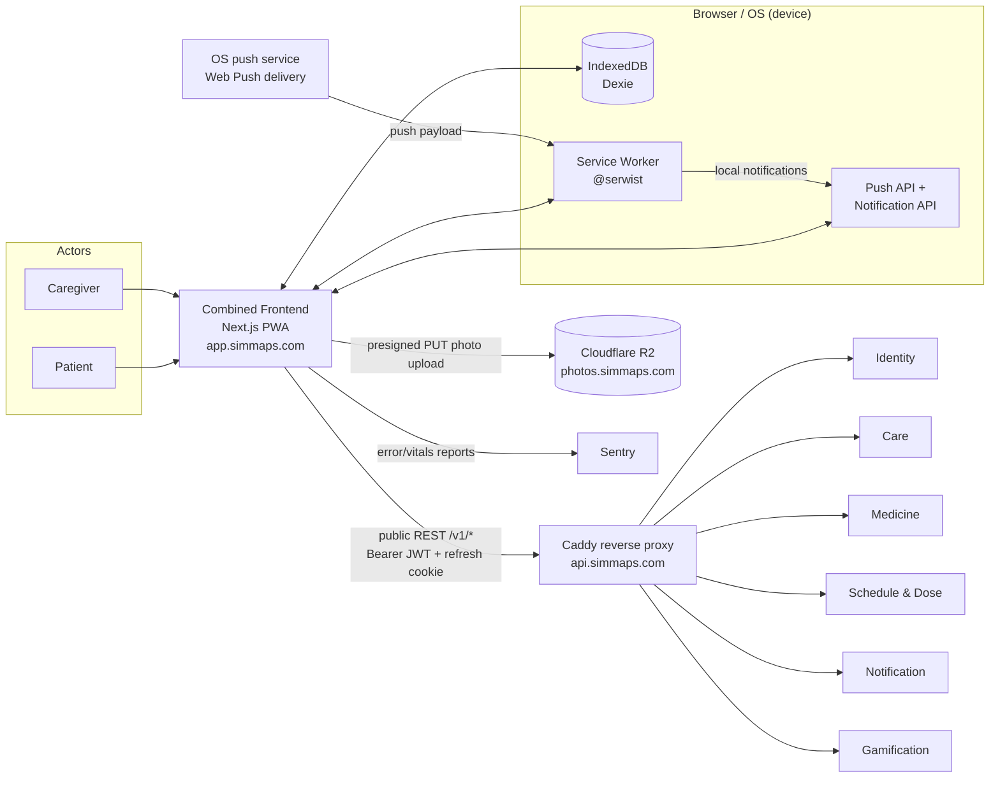
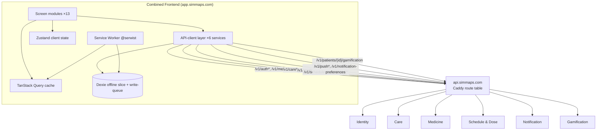
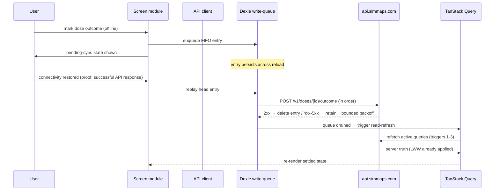
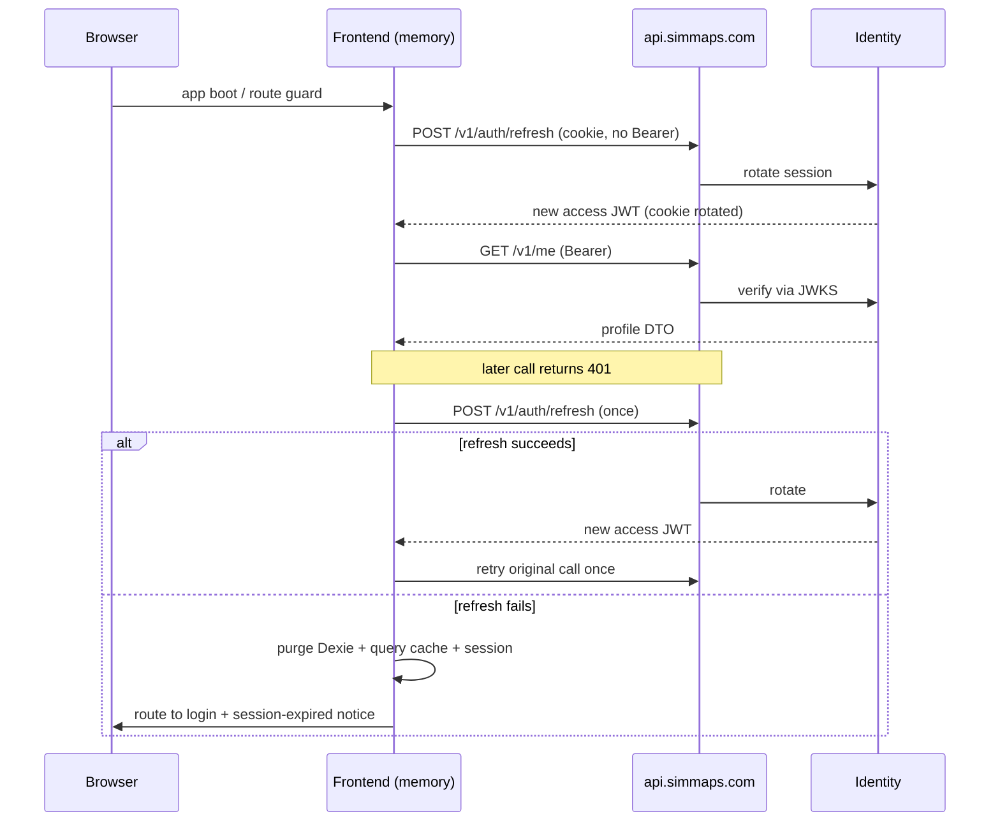
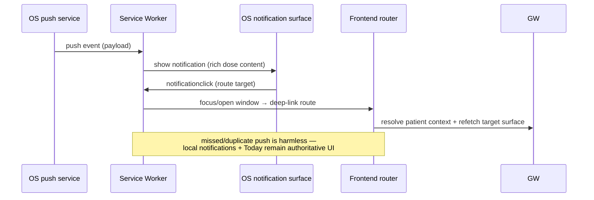

# HLD-MEDO-FRONTEND-001: Combined Frontend — screens, offline slice, service-worker push, and deployment

## 1. Document control header

Frontend | combined-frontend | PRD-MEDO-FRONTEND-001@1.0 | approved

## 2. Design context and scope

### 2.1 Upstream PRD consumed

`PRD-MEDO-FRONTEND-001@1.0` (status: approved). Sections consumed by reference: §2 goals G-1…G-7 and non-goals NG-1…NG-9; §3 actors; §4 user stories US-FE-01…12, §4.1 screen/module inventory, §4.2 flows UF-FE-01…13; §5 functional requirements FR-FE-001…108 grouped 5.1 session/auth/patient-context, 5.2 Today + dose actions, 5.3 medicines/catalog/photos, 5.4 scheduling, 5.5 care links/invites, 5.6 notifications/prefs/push, 5.7 offline store/write-queue/degraded mode, 5.8 profile/theming/account, 5.9 cross-cutting client behavior; §5.2 six-state table; §5.3 client-validation table; §6 NFRs NFR-FE-01…08; §6.2 accessibility/PWA constraints; §8 edge cases; §9 data requirements; §10 contract inventory (53 public routes verbatim); §11.4 offline behavior; §11.5 frontend integrations; §7.4 open questions OQ-FE-01…08. No requirement text is restated here (cite-don't-copy, hld-standard §6.1).

### 2.2 Component place in system

The Combined Frontend is Medo's single user-facing application (`frontend-map.md@2026-11-22`; Architecture Standard lines 222, 384–385): one Next.js 15 App Router PWA serving both Patient and Caregiver roles, deployed on Vercel at `app.simmaps.com`, reaching all six backend services exclusively through the public REST surface at `api.simmaps.com` (Caddy → service containers). It owns the presentation layer, client-side session mechanics, the TanStack Query server-state cache, the Zustand client-state store, the Dexie offline-critical slice + write-queue, the @serwist service worker (app-shell precache, photo caching, local-notification scheduling, Web Push handling), the push-subscription lifecycle, and the Monster Defense theme rendering.

It does NOT own: any business rule, classification, or authoritative state (all six services own their domains — the frontend renders DTOs and enqueues writes only, PRD NG-1); dose truth, outcome classification, missed-lock, or points (Schedule & Dose / Gamification); authorization decisions (every patient-scoped call is authorized server-side via Care `check-link`; the frontend is never trusted, `service-catalog.md` conventions line 11); event publication or consumption (not an event participant — §8); notification delivery (Notification service owns email/push/feed; the frontend owns subscription state and local scheduling only); authentication issuance (Identity owns tokens; the frontend stores and refreshes them client-side per locked mechanics); any database or service-internal access (never — Architecture Standard line 222).

### 2.3 Design goals

- DG-FE-1: API-first reads — every screen reads via TanStack Query → `api.simmaps.com` → services; Dexie is an offline cache only, never the source of truth. [`frontend-map.md@2026-11-22` conventions; `PRD-MEDO-FRONTEND-001@1.0#G-2`]
- DG-FE-2: Offline slice discipline — Dexie holds exactly the four locked families (dose rows, medicine display data, schedules, write-queue) within the locked scope (7-day dose window / all schedules / active medicines / all-linked-patients); everything else is API-only. [`inherited:.scratch/medo-hld/issues/03-frontend-offline-architecture.md@2026-11-23`; `PRD-MEDO-FRONTEND-001@1.0#FR-FE-080`]
- DG-FE-3: Ordered offline writes — one global FIFO write-queue; replay strictly in order on reconnect; conflicts resolve server-side last-write-wins; the client never merges or guesses. [`inherited:…/03-frontend-offline-architecture.md@2026-11-23`; `frontend-map.md@2026-11-22` Dexie contract]
- DG-FE-4: Degraded-mode honesty — binary online/degraded flag; engages on `offline` event OR failed API call; clears only on a successful API response; every surface renders an explicit degraded state. [`inherited:…/03-frontend-offline-architecture.md@2026-11-23`; `PRD-MEDO-FRONTEND-001@1.0#FR-FE-084/087`]
- DG-FE-5: Fan-out discipline — independent parallel TanStack Query calls per screen with per-section rendering; no chained calls, no backend aggregation endpoint. [`frontend-map.md@2026-11-22` line 9; `PRD-MEDO-FRONTEND-001@1.0#G-3`]
- DG-FE-6: Patient-context rule — Patient `patientId` = session `sub`; Caregiver `patientId` = selected Care Link's `patientId`; no patient-scoped call without a resolved context. [`frontend-map.md@2026-11-22` line 8; `PRD-MEDO-FRONTEND-001@1.0#FR-FE-005`]
- DG-FE-7: Push lifecycle completeness — VAPID fetch → permission-gated subscribe → per-device registration → logout unregister → silent resubscribe on server prune; iOS install gate precedes permission attempt. [`PRD-MEDO-FRONTEND-001@1.0#FR-FE-089…094`; `frontend-map.md@2026-11-22` line 27]
- DG-FE-8: Six-state rendering — every screen renders loading/empty/populated/error/offline-degraded/unauthorized states; no screen omits one. [`PRD-MEDO-FRONTEND-001@1.0#FR-FE-102`; `hld-standard.md` §5.6]
- DG-FE-9: Token hygiene — access JWT memory-only; refresh token exclusively in the `httpOnly` `SameSite=Lax` cookie; zero token/PII in Dexie, query persistence, URLs, or logs. [`PRD-MEDO-FRONTEND-001@1.0#FR-FE-002`; `inherited:.scratch/medo-backend/issues/06-auth-token-mechanics.md@2026-11-21`]
- DG-FE-10: Accessibility bar — WCAG 2.2 AA, keyboard-complete dose actions, `prefers-reduced-motion` respected, theme never sole carrier of state. [`PRD-MEDO-FRONTEND-001@1.0#NFR-FE-08/§6.2`]

### 2.4 Design non-goals

- Dexie schema versioning/field shapes, exact entity definitions → LLD (`OQ-FE-02`).
- Write-queue cap value + eviction detail, backoff parameters → LLD (`OQ-FE-03`; bound class fixed by HD-FE-05).
- Service-worker runtime-caching strategy detail for static assets, serwist config → LLD (`OQ-FE-04`; strategy categories fixed by HD-FE-08).
- Repository/folder/file layout, route file names, component names, Zod schemas, DTO field lists → LLD (hld-standard §6.5).
- RRULE expansion / schedule-materialization logic — dose rows arrive materialized from Schedule & Dose; the client never expands recurrence rules → LLD binds rendering only.
- Notification permission-prompt timing UX detail → LLD/design (`OQ-FE-06` carried).
- Email-fallback client surfacing → resolved silent v1 (§18.4); any future "check your email" hint is a future-map UX pass.
- Backend internals of any kind → sibling HLDs (identity/care/medicine/schedule-dose/notification/gamification v1.0 approved).
- Real-time channels (SSE/WebSocket) → rejected upstream; v1 updates = four refresh triggers only.

### 2.5 Inherited locked decisions

- Frontend stack: Next.js 15 App Router + TypeScript, Tailwind CSS v4 + shadcn/ui, TanStack Query + Zustand, Zod, Dexie, @serwist, Framer Motion, `@sentry/nextjs`, Vercel hosting (`inherited:PRD-MEDO-FRONTEND-001@1.0#§7.3`; feature-list cross-cutting).
- Domain: `simmaps.com` — `app.simmaps.com` (Vercel frontend), `api.simmaps.com` (Caddy→EC2), `photos.simmaps.com` (R2 custom domain); Cloudflare nameserver DNS; host-only `SameSite=Lax` refresh cookie on `api.`; `*.vercel.app` previews no-login v1 (`inherited:.scratch/medo-hld/issues/01-domain-selection.md@2026-11-22`).
- Deploy mechanism: frontend = Vercel Git integration on `main` (auto prod + previews); backend deploy via `medo-infra` repo + `deploy.sh` health-gate — not this component's concern beyond the API boundary (`inherited:.scratch/medo-hld/issues/02-cicd-deploy-mechanism.md@2026-11-23`).
- Offline architecture (HLD scope): Dexie 4 families + locked scope; single global FIFO write-queue `{entryId,type,patientId,doseId,payload,enqueuedAt}` + head-of-line blocking + bounded backoff + server LWW silent-correct; binary online/degraded flag fast-engage/proof-clear; SW = precache shell + CacheFirst photos + NetworkOnly API (`inherited:.scratch/medo-hld/issues/03-frontend-offline-architecture.md@2026-11-23`).
- API gateway: single public entry-point Caddy, explicit public-route table (unlisted = 404), per-service JWT verify pass-through, proxy-level CORS exact-origin allowlist (`inherited:.scratch/medo-backend/issues/05-api-gateway-entry-point.md@2026-11-21`).
- Auth token mechanics: user JWTs `iss/aud/sub/role/sid/iat/exp(25m)/jti` verified per-service via JWKS; refresh = hashed session rows + rotation + reuse-detection; internal service JWTs never used by frontend (`inherited:.scratch/medo-backend/issues/06-auth-token-mechanics.md@2026-11-21`).
- Rate limiting & caching: server-side classes only — the frontend is subject to them, never implements them; caller-side caches (directory 60s, check-link 15s) are service-side, not client (`inherited:.scratch/medo-backend/issues/09-rate-limiting-caching.md@2026-11-21`).
- Observability: `@sentry/nextjs` client + edge capture; Web Vitals reporting; PII/token scrubbing (`inherited:.scratch/medo-backend/issues/08-observability.md@2026-11-21`; `platform-observability.md@2026-11-21`).
- Quality/ops baselines: `platform-quality-baseline.md@2026-11-21`, `scheduled-jobs.md@2026-11-21` (frontend = zero jobs), `platform-observability.md@2026-11-21`.
- Contract surfaces: `service-catalog.md@2026-11-22` (53 public routes consumed; internal routes never called), `frontend-map.md@2026-11-22` (per-screen calls, patientId rule, Dexie contract, refresh triggers).
- Feature rules: six-state UX, Monster Defense theme states, WCAG 2.2 AA, offline-first, PWA+@serwist, Vercel (`docs/features/feature-list.md@2026-11-20`; PRD §7.3).

## 3. System context

FIG-FE-01: system context diagram

| Counterparty | Relationship (calls/consumes/publishes/is-called-by) | Contract(s) |
|---|---|---|
| Patient / Caregiver | is-called-by (UI actor) | all screens (§9) |
| Identity Service | calls public REST | `POST /v1/auth/*`, `GET/PATCH/DELETE /v1/me` (§9) |
| Care Service | calls public REST | `/v1/care/links*`, `/v1/care/invites*` (§9) |
| Medicine Service | calls public REST | `/v1/medicines*`, `/v1/medicine-catalog*` (§9) |
| Schedule & Dose Service | calls public REST | `/v1/patients/{id}/schedules*`, `/v1/schedules/{id}*`, `/v1/patients/{id}/doses*`, `/v1/doses/{id}*` (§9) |
| Notification Service | calls public REST | `/v1/notifications*`, `/v1/notification-preferences`, `/v1/push/*` (§9) |
| Gamification Service | calls public REST | `GET /v1/patients/{id}/gamification` (§9) |
| Caddy reverse proxy | entry path for all API calls; enforces public-route table + CORS | `inherited:ticket-05@2026-11-21` |
| Cloudflare R2 | direct presigned-PUT photo upload + public-read photo GETs | Medicine catalog photo two-step (§9); `inherited:ticket-04@2026-11-21` |
| OS push service / browser Push API | delivers server Web Push to SW; `pushManager.subscribe` produces `{endpoint,p256dh,auth}` | Push API (platform); `POST/DELETE /v1/push-subscriptions` (§9) |
| Browser/OS APIs | IndexedDB (Dexie), Service Worker, Notification API, online/offline events, `prefers-reduced-motion` | platform APIs — no Medo contract |
| Sentry | error + Web Vitals reporting | `inherited:platform-observability.md@2026-11-21` |
| Vercel | hosts the application bundle + edge network | platform — `inherited:ticket-02@2026-11-23` |

## 4. Application topology and service boundaries

### 4.1 Deployable unit & entry path

Deployable unit: one Vercel project serving the Next.js 15 App Router application at `app.simmaps.com` (`inherited:.scratch/medo-hld/issues/01-domain-selection.md@2026-11-22`; deploy = Vercel Git integration on `main`, `inherited:…/02-cicd-deploy-mechanism.md@2026-11-23`). Entry path: browser → `https://app.simmaps.com` (Vercel CDN/edge) for the application shell and static assets; browser → `https://api.simmaps.com/v1/*` (Caddy public-route table → service container) for every data call. There is no third path: the frontend never calls service hosts, never touches `broker_db`, never reaches internal routes (they are absent from the public route table AND independently service-JWT gated — `inherited:ticket-05@2026-11-21`). Photo bytes move browser → `photos.simmaps.com` (R2) directly via short-lived presigned PUT/GET URLs issued by Medicine — the only non-`api.` backend touchpoint.

### 4.2 Boundary statement

The Combined Frontend owns the entire patient/caregiver experience: routing and guards, the 13 screen modules of `frontend-map.md`, per-screen parallel fan-out composition, client-side session mechanics (token custody, silent refresh, logout purge), the Dexie offline-critical slice and FIFO write-queue, the service worker's three caching roles + local-notification scheduling + Web Push handling, the push-subscription lifecycle, and Monster Defense theme/motion rendering.

Denied capabilities (explicit): business rules and authoritative state of every domain — doses, outcomes, schedules, medicines, catalog, care links, invites, notifications feed/prefs, push delivery, gamification state (each owned by its service per `service-catalog.md` headings); authorization decisions (server-side `check-link`/session/JWT — the frontend renders denials, never pre-empts them); event publication/consumption; internal REST consumption; database access of any kind; notification delivery (Notification service owns Resend email + Web Push fan-out — the frontend owns subscription state and on-device scheduling only); authentication issuance (Identity owns signup/login/token minting — the frontend owns custody and refresh mechanics only); account-deletion business logic (Identity executes; the frontend renders the block and runs the client purge).

### 4.3 Boundary invariants

- One combined frontend for both roles — role differences are runtime (`patientId` rule + role-gated UI), never separate builds or apps (PRD §13).
- DTOs at every boundary: the frontend consumes public REST DTOs only; it never sees internal models, never shares schemas with any service (Architecture Standard lines 222, 236, 306, 371–372).
- The frontend is never trusted for authz: every patient-scoped call carries the session JWT and is authorized server-side; UI hiding is convenience, never a security boundary (catalog conventions line 11; PRD FR-FE-100/101).
- Client state is partitioned into exactly three stores with non-overlapping ownership (HD-FE-02): TanStack Query server-state cache, Zustand client/session state, Dexie offline slice.
- All API traffic flows through `api.simmaps.com`; CORS is terminated once at the proxy with an exact-origin allowlist — the frontend adds no CORS logic (ticket 05/06).

FIG-FE-02: frontend ↔ services map

## 5. Decomposition and internal structure

§5.1 module decomposition — logical modules by responsibility (folder/file layout is LLD):

| Block | Responsibility | Layer-equivalent | Contracts/events | HD-ref |
|---|---|---|---|---|
| auth-session module | Signup/login/verify/forgot/reset/logout flows; access-JWT custody (memory-only); single 401→silent-refresh→retry-once path; session-expired routing; logout purge orchestration | client module | Identity `POST /v1/auth/*`, `GET/PATCH/DELETE /v1/me` | HD-FE-03 |
| patient-context module | `patientId` rule resolution (Patient = session `sub`; Caregiver = switcher selection); links list fetch; link-end detection → context revoke + "link ended" banner; no-access routing | client module | Care `GET /v1/care/links`, `GET /v1/care/invites` | HD-FE-04 |
| identity API client | Typed calls to Identity public REST | api-client | Identity routes (§9) | HD-FE-01 |
| care API client | Typed calls to Care public REST | api-client | Care routes (§9) | HD-FE-01 |
| medicine API client | Typed calls to Medicine public REST incl. photo two-step + catalog | api-client | Medicine routes (§9) | HD-FE-01 |
| schedule-dose API client | Typed calls to Schedule & Dose public REST incl. outcome/snooze writes | api-client | Schedule & Dose routes (§9) | HD-FE-01 |
| notification API client | Typed calls to Notification public REST incl. prefs + push-subscriptions + vapid-key | api-client | Notification routes (§9) | HD-FE-01 |
| gamification API client | Typed call to the single Gamification read route | api-client | `GET /v1/patients/{id}/gamification` | HD-FE-01 |
| query/state layer | TanStack Query server-state cache + four refresh triggers + per-section query keys; Zustand client/session state (connectivity flag, patient context, session meta) | state | all consumed contracts | HD-FE-02 |
| offline store | Dexie object stores (4 families) + global FIFO write-queue + replay engine + bounded backoff + pending-sync metadata | state (client persistence) | replays to `POST /v1/doses/{id}/outcome`, `POST /v1/doses/{id}/snooze` | HD-FE-05 |
| service worker + push | @serwist SW lifecycle (precache/CacheFirst/NetworkOnly), push-event handler, notificationclick deep-linking, local-notification scheduler reading Dexie, push-subscription lifecycle | service-worker | Push API, Notification API, Dexie reads; `GET /v1/push/vapid-key`, `POST/DELETE /v1/push-subscriptions` | HD-FE-07, HD-FE-08 |
| screen modules | 13 screens per `frontend-map.md` rows grouped by domain (auth suite, profile+switcher, Today+dose actions, medicines+catalog+photos, scheduling builder, care links/invites, notifications feed+prefs, push settings, gamification surfaces) | client module (screens) | per §9 wiring | HD-FE-01, HD-FE-09 |
| shared UI/theme | Design system (Tailwind v4 + shadcn/ui), Monster Defense theme engine (Harmony/Uneasy/Horror tokens + Today scene), Framer Motion wrappers with reduced-motion gate, six-state primitives | client module (shared) | gamification DTO (theme input only) | HD-FE-09 |

Flow pattern: screens compose → api-clients issue calls through one gateway base-URL + auth interceptor → TanStack Query caches server state; offline-critical reads/writes additionally flow through the offline store; the service worker operates independently of the page (push events, local notifications, asset caching). Deviation note: there is no four-layer backend flow — the frontend's equivalent discipline is the three-store partition (HD-FE-02) and the api-client boundary (all HTTP leaves through exactly six typed clients, HD-FE-01).

## 6. Data architecture

### 6.1 Owned store & entity inventory

Client-owned persistent data = the Dexie (IndexedDB) database on each device — the only client persistence boundary. Entity inventory at ownership granularity (lifecycle classes; field shapes are LLD, `OQ-FE-02`):

| Entity (family) | Lifecycle | Ownership | Notes |
|---|---|---|---|
| Cached dose rows (doseId, scheduled times, outcome, `snoozedUntil`, patientId, medicine display join) | written on read-refresh triggers → updated on mutation/replay → evicted by window rollover | this client device, per `patientId` slice | offline-critical slice; NOT dose truth — server canonical |
| Cached medicine display data (medicineId, name, photo URL, dosage) | written alongside dose/medicine reads → refreshed on triggers | this client device | powers offline Today + local-notification text |
| Cached schedules (future dose times per medicine) | written on schedule reads → refreshed on triggers | this client device | local-notification scheduling input |
| Write-queue entries `{entryId,type,patientId,doseId,payload,enqueuedAt}` | enqueue offline → FIFO replay → delete on success → bounded cap (LLD) | this client device | survives reload; purged on logout/account-delete |
| Ephemeral (never Dexie): TanStack Query cache, last-known gamification display values, session meta | in-memory per session | this client device | "last-known or hide" per frontend-map; persisting gamification to Dexie forbidden |
| Push subscription record (endpoint → server id) | created on grant → deleted on logout | server owns record (Notification DB); client holds endpoint key in platform subscription store | `DELETE /v1/push-subscriptions/{id}` on logout |

### 6.2 Shared / consumed data

All server data is consumed via public REST contracts only (§9) — never replicated schemas, never peer-DB access. Shared/community data touched: Medicine Catalog entries (community-maintained, never owned — read + create/edit via catalog routes; last-write-wins shared edits per catalog rules). Read-through data owned by other services: everything else — dose truth (Schedule & Dose), medicines (Medicine), links/invites (Care), feed/prefs/subs (Notification), points/theme (Gamification), profile/session (Identity). The frontend holds no authoritative copy of any of it; Dexie contents are explicitly non-authoritative caches.

### 6.3 Consistency & coordination model

- Reads: server-authoritative always. TanStack Query is a cache, not a store of record; Dexie mirrors the offline-critical slice for display + local notifications only.
- Writes: online writes go direct to the API (optimistic UI permitted for dose marks with pending state; server response is truth). Offline-eligible writes (dose outcome, snooze) enqueue FIFO and replay in order on connectivity restore; replay precedes the post-reconnect read-refresh so the UI settles on post-replay truth.
- Conflicts: server-authoritative last-write-wins — the client never merges, guesses, or resolves; after replay it refetches and renders server state (silent-correct).
- Multi-actor consistency: no client-side coordination — caregiver marks propagate via the four refresh triggers (15-min `refetchInterval` on Today queries while visible catches cross-actor changes).
- Events: none — the frontend is not an event participant (§8); there is no outbox, no `broker_db` access, no `last_event_id`.

### 6.4 Retention & deletion

- Dexie (all four families + queue): purged on logout (single or all-devices), on account-deletion success, and per-patient-context slice on detected link-end; no time-based retention — demand-refreshed cache (`PRD-MEDO-FRONTEND-001@1.0#§9.4`).
- Write-queue: retained until replay success or purge trigger; bounded defensively (cap → LLD, `OQ-FE-03`/`OQ-HLD-FE-02`).
- Push subscription: `DELETE` on logout; server-side orphan pruning (404/410/403) with client silent resubscribe.
- Service-worker caches: precached app shell versioned per deploy; `photos.simmaps.com` CacheFirst entries evictable per SW cache policy (LLD detail, `OQ-FE-04`); API responses are never cache-stored (NetworkOnly).
- Backups: none — device-local by nature; server remains the system of record.

FIG-FE-03: offline-sync flow

## 7. External contracts

### 7.1 Exposed contracts

**None.** The frontend is a client: it exposes no REST routes, publishes no events, and registers no webhooks. The only inbound surfaces are platform-level (Vercel serving the bundle; the browser's service-worker/push APIs) — no Medo contract.

### 7.2 Consumed contracts

The frontend consumes **53 public REST routes** across the six services — the verbatim inventory lives in `PRD-MEDO-FRONTEND-001@1.0#§10` and is bound row-for-row in §9 (the combined-frontend contract map, which per hld-standard §3.7/§5.5 supersedes a duplicated table here). Summary by provider:

| Provider | Consumed surface (public REST only) | Internal routes consumed |
|---|---|---|
| Identity | 12 routes — `POST /v1/auth/{signup,login,refresh,logout,logout-all,forgot-password,reset-password,verify-email,resend-verification}`, `GET/PATCH/DELETE /v1/me` | none — `/v1/users/{id}` is service-only |
| Care | 9 routes — invites create/preview/accept/decline/resend/cancel/list + links list/end | none — `check-link`, `patients/{id}/links` are service-only |
| Medicine | 13 routes — catalog browse/detail/create/patch/photos two-step + medicines list/create/detail/patch/archive/delete | none — internal `GET /v1/medicines/{id}` not called (public route covers it) |
| Schedule & Dose | 9 routes — schedules list/create/detail/patch/delete + doses window/detail + outcome + snooze | none — `/v1/doses/due`, `has-dose-records` are service-only |
| Notification | 9 routes — feed list/unread-count/read/read-all + prefs GET/PUT + vapid-key + push-subscriptions POST/DELETE | none — service exposes no internal REST |
| Gamification | 1 route — `GET /v1/patients/{id}/gamification` | none — service exposes no internal REST |

Authz binding: session JWT (`Authorization: Bearer`) on all non-public routes; patient-scoped routes additionally authorized server-side (patient-self or Care `check-link`); invite-token preview routes are locator-only; three routes are fully public (`signup`, `login`, `forgot-password`, `verify-email`, `resend-verification`, `vapid-key`, invite preview — per catalog authz column). Idempotency: read routes n-a; mutating routes rely on server semantics — outcome re-mark = new POST (last-write-wins), queue replay is client-ordered; `POST /v1/push-subscriptions` dedups by endpoint; archive/delete/link-end are naturally idempotent. Rate-limit class: server-enforced per ticket 09 (public 30/min/IP, auth'd writes 60/min/user, auth'd reads 300/min/user) — the frontend surfaces 429 + `Retry-After`, never implements limiting. Failure behavior per row → §14.

## 8. Integration events and workflows

### 8.1 Published events

**Not an event participant — publishes none.** The frontend emits no domain events; there is no outbox, no `broker_db` access.

### 8.2 Consumed events

**Not an event participant — consumes none.** Freshness arrives exclusively via REST reads (four refresh triggers) and Web Push payloads (display-only notifications, not state).

### 8.3 Explicit none-statements

- Publishes: none — no event production, no outbox table, no `@medo/eventing` publisher usage.
- Consumes: none — no `broker_db.events` polling, no `last_event_id` offset, no `dead_letters` interaction.
- Subscribes (messaging): none beyond the platform Push API subscription lifecycle (§11.4/§15.2) — that is a Notification-service contract, not event consumption.

### 8.4 Cross-service workflows (realtime/refresh flows)

The frontend substitutes event-driven freshness with four locked refresh triggers (`frontend-map.md@2026-11-22` lines 43–48) plus platform push. Workflows:

| Workflow | FIG | Coordination model per hop | Failure semantics |
|---|---|---|---|
| Session establishment & silent refresh | FIG-FE-04-1 | browser → Identity `POST /v1/auth/login` (sync) → cookie set by Identity via proxy → subsequent calls carry Bearer; on 401 → one `POST /v1/auth/refresh` → retry once | refresh failure → purge + login redirect (§14) |
| Dose mark — online | FIG-FE-04-2 | screen → Schedule & Dose `POST /v1/doses/{id}/outcome` (sync) → mutation response → trigger 3 refetch of Today queries | failure → error toast + revert optimistic state (§14) |
| Dose mark — offline → replay | FIG-FE-03 (§6) | Dexie FIFO enqueue → on proof-of-connectivity replay in order → server LWW → refetch | per-entry retain + bounded backoff; head-of-line blocking (§14.3) |
| Multi-actor freshness | — | TanStack Query `refetchInterval` ≈15 min on Today queries while tab visible + triggers 1–3 | hidden tab suspends interval; failed refetch → section error state only |
| Web Push receive → tap | FIG-FE-04-3 | OS push service → SW `push` event → OS notification → `notificationclick` → deep-link route | stale/unknown route → Today fallback; push is best-effort backup (§14) |
| Local notification action | FIG-FE-04-4 | SW-scheduled notification → Taken/Snooze action → same write path as dose mark (API or queue) | identical failure semantics to dose-mark workflows |
| Connectivity transition | FIG-FE-04-5 | `offline` event or failed API call → degraded engage; successful API response → proof-clear → queue replay + refetch | flap guard = binary flag; no hysteresis needed at envelope (§14.1) |

FIG-FE-04-1: session + silent-refresh sequence

FIG-FE-04-3: Web Push receive → deep-link

## 9. Frontend contract surface — the combined-frontend contract map

This section IS the "combined-frontend contract map" element (Architecture Standard line 332; hld-standard §5.5). It binds every `frontend-map.md@2026-11-22` "Per-screen service calls" row to an owning module, exact contract IDs, the parallel fan-out pattern, the patient-context source, and the offline classification. **Aggregation rule (restated as constraint):** independent parallel TanStack Query calls per screen, per-section skeleton rendering, NO backend aggregation endpoint, no chained calls (`frontend-map.md` line 9). **Surface rule:** public routes only — internal routes are never called. **Auth flow:** `Authorization: Bearer <access JWT>` on session routes; refresh via `httpOnly` cookie through the proxy; frontend never asserts authz.

| frontend-map row | Owning module(s) | Contract IDs (verbatim) | Sync pattern | patientId source | Offline classification |
|---|---|---|---|---|---|
| Auth: signup / login / refresh / logout / forgot / reset / verify-email | auth-session | `POST /v1/auth/signup`, `POST /v1/auth/login`, `POST /v1/auth/refresh`, `POST /v1/auth/logout`, `POST /v1/auth/logout-all`, `POST /v1/auth/forgot-password`, `POST /v1/auth/reset-password`, `POST /v1/auth/verify-email`, `POST /v1/auth/resend-verification` | single-call flows (not fan-out) | n-a (session establishment) | API-only — auth impossible offline; degraded mode N/A |
| Own profile (view/edit) | auth-session + profile screen | `GET /v1/me`, `PATCH /v1/me`, `DELETE /v1/me` | single calls | session `sub` | API-only — cached read-only view permitted, save requires connection |
| **Today** (dose list + theme + points + notifications) | today screen + query layer | Schedule & Dose `GET /v1/patients/{id}/doses?from=today&to=today` · Gamification `GET /v1/patients/{id}/gamification` · Notification `GET /v1/notifications`, `GET /v1/notifications/unread-count` · Medicine `GET /v1/medicines?patientId=` | **4-way parallel fan-out**, per-section render | Patient: session `sub`; Caregiver: selected link `patientId` | doses + medicines = Dexie-cached; gamification + feed = API-only (last-known or hide) |
| Dose actions (taken/skipped/snooze) | dose-actions + offline store | Schedule & Dose `POST /v1/doses/{id}/outcome`, `POST /v1/doses/{id}/snooze` | mutation → trigger-3 refetch | resolved `patientId` in dose DTO context | write-queue when offline; online direct |
| Medicines list | medicines screen + medicine client | Medicine `GET /v1/medicines?patientId=`; catalog search `GET /v1/medicine-catalog?q=` | parallel (list + search sections) | resolved `patientId` | medicines display data Dexie-cached; catalog search API-only |
| Medicine detail / edit / archive / delete | medicine-detail screen | Medicine `GET/PATCH /v1/medicines/{id}`, `POST /v1/medicines/{id}/archive`, `DELETE /v1/medicines/{id}`; catalog detail `GET /v1/medicine-catalog/{id}` | detail → dependent sections (not chained API calls — one detail call + cached joins) | resolved `patientId` | read-only cached view or requires-connection |
| Add medicine (adopt catalog) | add-medicine screen | Medicine `POST /v1/medicines`; unknown → `POST /v1/medicine-catalog` first; catalog search `GET /v1/medicine-catalog?q=` | ordered two-step flow (catalog-entry precondition) | resolved `patientId` | API-only — requires connection |
| Medicine/catalog photos | photo-upload module (medicine client) | `POST /v1/medicine-catalog/{id}/photos` or `POST /v1/medicines/{id}/photos` → `{photoKey, uploadUrl}` → direct PUT → `PUT .../photos/{slot}` | two-step signed-URL flow | resolved `patientId` | API-only for issue/confirm; photo GETs CacheFirst via SW |
| Scheduling builder + exceptions | scheduling-builder screen | Schedule & Dose `GET/POST /v1/patients/{id}/schedules`, `GET/PATCH/DELETE /v1/schedules/{id}` | builder CRUD; schedule list parallel to detail sections | resolved `patientId` | schedules Dexie-cached for display/notifications; mutations API-only |
| Care Links management (invites, links, end) | care-links screen + patient-context | Care `POST /v1/care/links/invites`, `GET /v1/care/invites/{token}`, `POST /v1/care/invites/{token}/accept`, `POST /v1/care/invites/{token}/decline`, `POST /v1/care/invites/{id}/resend`, `POST /v1/care/invites/{id}/cancel`, `GET /v1/care/invites`, `GET /v1/care/links`, `POST /v1/care/links/{id}/end` | list sections parallel; invite actions sequential by nature | n-a for invites (session/email-scoped); links feed patient-context | API-only per frontend-map — never Dexie-cached |
| Notifications feed + prefs | notifications screen | Notification `GET /v1/notifications?cursor=`, `GET /v1/notifications/unread-count`, `POST /v1/notifications/{id}/read`, `POST /v1/notifications/read-all`, `GET /v1/notification-preferences`, `PUT /v1/notification-preferences` | feed + badge parallel; mark-read mutations → refetch | session-scoped (not patientId) | feed API-only (last-known badge or hide); prefs API-only |
| Push subscription lifecycle | push-lifecycle module (SW + notification client) | Notification `GET /v1/push/vapid-key`, `POST /v1/push-subscriptions`, `DELETE /v1/push-subscriptions/{id}` | lifecycle calls (not screen fan-out) | session-scoped | n-a — lifecycle runs online; local notifications work offline regardless |
| Caregiver gamification view | today/gamification surfaces (same screen) | Gamification `GET /v1/patients/{id}/gamification` — same endpoint | part of Today fan-out | selected link `patientId` (check-link per read, server-side) | API-only — last-known or hide; read-only |

Contract coverage: all 53 routes of `PRD-MEDO-FRONTEND-001@1.0#§10` appear across the rows above (auth 12, profile 3 incl. delete, care 9, medicine catalog 6 + patient 7, schedule-dose 9, notification 9, gamification 1 — totals per §7.2). Zero deviations vs `frontend-map.md`; zero internal-route consumption; publishes none.

## 10. Cross-cutting concerns

### 10.1 Authentication & authorization summary

Two trust domains exist platform-wide; the frontend participates only in the user domain. User JWTs: Identity-signed asymmetric, claims `iss/aud/sub/role/sid/iat/exp(25m)/jti`, verified per-service via JWKS — the frontend never verifies, only attaches (`inherited:ticket-06@2026-11-21`). Service JWTs are never minted or held client-side. The frontend's authz posture: it asserts nothing — every denial is rendered (no-access page, role explanations, guard messages). Patient-scoped authorization is Care `check-link` per request server-side with positive-only ≤15 s cache (`inherited:ticket-09@2026-11-21`); the frontend's only authz-adjacent logic is route guarding (session/verified/role) which is UX, not security.

### 10.2 Observability binding

`platform-observability.md@2026-11-21` + `inherited:ticket-08@2026-11-21`: `@sentry/nextjs` client + edge capture with PII/token scrubbing (`beforeSend`); Web Vitals (LCP/INP/CLS) reported; error boundaries per route section; no console logging of tokens/health data. Frontend deltas: no `/metrics` endpoint (platform metric surface is service-side — stated N/A, not omitted); no `requestId` generation (the gateway/service owns correlation — the frontend propagates nothing it doesn't receive); queue-depth/replay telemetry is client-side analytics, privacy-safe counts only (PRD §12 G-2).

### 10.3 Resilience binding

Client-side dependency rows (server-side matrix rows are the services' own — `platform-quality-baseline.md@2026-11-21` cited for the envelope they sit inside):

| Dependency | Timeout/retry (client view) | On failure |
|---|---|---|
| api.simmaps.com (all REST) | browser/fetch defaults; TanStack Query retry policy per query class (LLD tuning) | degraded mode engages on failed-call signal; per-section error + retry; writes queue or fail per §14 |
| photos.simmaps.com (R2 GET/PUT) | presigned URL direct transfer | photo slot stays empty with retry; orphan `photoKey` is server-side concern (resolved — retained per Medicine HD-MED-03) |
| OS push service → SW | platform-managed | best-effort backup; missed push never blocks local notifications or Today |
| IndexedDB (Dexie) | synchronous API | failure → recoverable error screen, never white-screen (FR-FE-088) |
| Vercel edge/bundle | platform | app shell served from cache/precached bundle even when API down (NFR-FE-02) |

### 10.4 Rate limiting & caching

Server-enforced only (`inherited:ticket-09@2026-11-21`): public 30/min/IP, auth'd writes 60/min/user, auth'd reads 300/min/user, internal exempt; 429 + `Retry-After` + JSON error. Client obligations: surface `Retry-After`-aware messaging on 429 (login cooldown countdown per FR-FE-009, resend-cap explanations); never implement client-side rate limiting as a security control; the ~15-min `refetchInterval` + four-trigger discipline IS the client's self-imposed fetch budget (NFR-FE-03). Client caches: TanStack Query (memory, per-session), Dexie (persistent offline slice — the only persisted cache), SW CacheFirst photos + precache shell; no other HTTP caching — API responses are NetworkOnly.

### 10.5 Error handling & input protection

Standard JSON error body consumed as-is; field-mapped display where the server provides field errors; `Retry-After` honored for cooldown UX. Fail-cleanly rule applied client-side: clear error states per §5.2 six-state table, never crash/hang/white-screen; degraded where cheap (per-surface); no silent data loss (queue retains failed writes). Input protection: Zod validation at form boundaries (UX only — server authoritative, FR-FE-101); no `eval`/`innerHTML` on user content (NFR-FE-04); DTO-shaped rendering only.

### 10.6 Sensitive-data handling

Access JWT: memory-only (in-memory module state), never localStorage/sessionStorage/IndexedDB/URL/logs (FR-FE-002, DG-FE-9). Refresh token: `httpOnly` cookie — JS-inaccessible by design. Dexie contents = health-adjacent adherence data (dose times, outcomes, medicine names/photos) — device-local, purged per §6.4; never synced except queue-replay payloads to the outcome/snooze routes. Notification payloads carry dose display fields visible on lock screen by OS design — no clinical detail beyond dose display needs. Sentry scrubbing mandatory for tokens/PII/health data (NFR-FE-05/06). Secrets: none held client-side beyond the public VAPID key (public by design) and presigned URLs (short-lived, single-object).

## 11. Security architecture

### 11.1 Trust boundaries

| Boundary | Mechanism | Notes |
|---|---|---|
| Browser ↔ app.simmaps.com | HTTPS via Vercel edge | application shell + static assets; no Medo data at rest server-side beyond platform logs |
| Browser ↔ api.simmaps.com | HTTPS; CORS terminated once at Caddy proxy, exact-origin allowlist + credentials for the cookie | `inherited:ticket-05/06@2026-11-21`; preview origins (`*.vercel.app`) have no cookie auth in v1 — accepted (`inherited:ticket-01@2026-11-22`) |
| app ↔ services | user JWT Bearer (per-service JWKS verify) + host-only `HttpOnly; Secure; SameSite=Lax; Path=/v1/auth` refresh cookie | cookie set by Identity through the proxy; frontend never reads it |
| app ↔ R2 photos | presigned PUT (upload) + public-read GET URLs | unguessable keys; bucket public-read for catalog photos (`inherited:ticket-04@2026-11-21`) |
| invite-token routes | locator-only token in URL → public preview; accept/decline require Caregiver session | token is never authorization (`service-catalog.md` conventions line 12) |

Internal routes (`/v1/doses/due`, `has-dose-records`, `/v1/users/{id}`, `check-link`, `patients/{id}/links`) are unreachable publicly AND independently service-JWT gated — the frontend has no code path to them and must never gain one.

### 11.2 Token lifecycle binding

Access JWT: 25-min exp, held in memory only; lost on reload → boot path runs silent `POST /v1/auth/refresh` (cookie) to rehydrate (§8.4 FIG-FE-04-1). Refresh: rotation on every use, reuse-detection revokes the session server-side (`inherited:ticket-06@2026-11-21`). Client obligations: exactly one refresh attempt per 401 (no retry loops — FR-FE-003); on refresh failure purge all client state (Dexie + query cache + session) and route to login; logout/logout-all/reset/delete all end in the same purge sequence (FR-FE-010/107/108). Revocation lag ≤25 min on access tokens is an accepted platform bound — the client does not compensate.

### 11.3 Data exposure analysis

| Data | Crossing | Class |
|---|---|---|
| Dose outcomes/marks | app → api.simmaps.com (Bearer) | health-adjacent adherence data; TLS in transit; server-owned at rest |
| Medicine photos | app → photos.simmaps.com (presigned) | catalog photos public-read by design; private medicine has no own photos (catalog-entry-only — OQ-FE-08 resolved) |
| Push subscription `{endpoint,p256dh,auth}` | app → Notification `POST /v1/push-subscriptions` | device-addressing material; server stores per device; deleted on logout |
| VAPID public key | Notification → app | public key by design |
| Dexie slice | device-local only | never leaves device except queue-replay payloads; purged per §6.4 |
| Invite/reset/verify tokens | email links → app routes | locator credentials; single-use; expiry server-enforced |
| Logs/telemetry | app → Sentry | scrubbed: no tokens, no health-detail beyond dose display needs |

### 11.4 Abuse controls

Client-side enforcement points (server remains authoritative): login cooldown countdown surfaced from server error (FR-FE-009); forgot/reset rate-limit messaging; invite resend-cap display; push permission denial → degraded prompt not a loop; client validation is UX only and explicitly not a security boundary (FR-FE-101). Platform abuse controls are server-side and cited, not re-implemented: rate-limit classes (ticket 09), login-failure cooldown 3-fail→25 min, forgot-password 2/hr, invite resend caps, session rotation/reuse-detection.

### 11.5 PWA & push architecture (§5.4)

- Installable PWA: manifest + icons + `display: standalone`; installability is a first-class flow — on iOS, push is impossible without an installed PWA, so the install prompt (Add to Home Screen guidance) precedes any permission attempt and is re-surfaced in reminder-relevant contexts (FR-FE-090).
- Push lifecycle: `GET /v1/push/vapid-key` once per session (memory-cached `applicationServerKey`) → `Notification.requestPermission()` only in user-gesture context → on grant `pushManager.subscribe` → `POST /v1/push-subscriptions {endpoint,p256dh,auth}` once per device (dedup by endpoint) → `DELETE /v1/push-subscriptions/{id}` on logout; server prune signals (404/410/403) → silent resubscribe + re-POST on next check, never user-surfaced (FR-FE-089/093).
- Service-worker update strategy: @serwist SW with precached app shell; updates apply on next navigation and never interrupt an in-progress dose mark (in-flight writes live in Dexie, not SW memory) (FR-FE-094).
- Auth-email/push boundary: Notification service owns ALL delivery (Resend email, Web Push fan-out, feed rows); the frontend owns subscription state + on-device local-notification scheduling only — no handoff logic between local and push channels (they are independent backups, `frontend-map.md` line 50).

## 12. Deployment topology and assumptions

### 12.1 Runtime & platform binding

Next.js 15 App Router + TypeScript on Vercel (`inherited:PRD-MEDO-FRONTEND-001@1.0#§7.3`; stack locked upstream). SSR, if used, must not block on Medo service availability — client fetch preferred for patient data (PRD §6.2). No Medo backend code runs in the frontend deployable.

### 12.2 Entry path & network position

Browser → `app.simmaps.com` (Vercel edge/CDN) for shell + assets; browser → `api.simmaps.com` → Caddy public-route table → service containers for all data; browser → `photos.simmaps.com` (R2) for photo bytes via signed/public URLs. The frontend sits outside the EC2 Compose topology entirely — its only backend dependency is the public REST surface.

### 12.3 Environments & secrets

Vercel Git integration on `main`: production deploys + preview deployments automatic (`inherited:…/02-cicd-deploy-mechanism.md@2026-11-23`). Environments: local dev (framework dev server against local compose API or prod API per dev plan — LLD detail) + Vercel production; no staging (ticket 02). Secrets/env: API base URL via env config; no secrets client-side beyond public VAPID key fetch; `*.vercel.app` preview origins cannot authenticate in v1 (accepted — `inherited:ticket-01@2026-11-22`).

### 12.4 Resource & scaling assumptions

Static/edge-served bundle; per-device Dexie — no shared client state, nothing to scale horizontally. Envelope position: <50 concurrent users, <5k dose events/day (`platform-quality-baseline.md@2026-11-21`); the frontend's scaling exposure is per-screen fan-out (max 4 parallel calls on Today) and per-device IndexedDB footprint (bounded slice + capped queue). Vercel platform absorbs traffic; no capacity planning needed at envelope.

### 12.5 Health, jobs hooks & deploy checks

No `/health` or `/ready` endpoint exists client-side — platform health is Vercel's concern; the meaningful deploy check is build success + smoke navigation (LLD/ops detail). **Zero scheduled jobs** — explicit per `scheduled-jobs.md@2026-11-21` (frontend row = none; client-side notification scheduling is not a scheduled job, PRD §7.3). Deploy verification: Vercel build + the app's own boot path (silent refresh → `/v1/me`) is the functional smoke check.

### 12.6 Assumptions register

- Vercel preview deployments stay no-login in v1 (accepted at ticket 01; revisit if preview-auth testing becomes necessary — owner: user; trigger: first need for authenticated preview testing).
- iOS push depends on user installing the PWA — platform constraint treated as requirement, not bug (PRD §13).
- Browser API availability (IndexedDB, SW, Push, Notification) assumed on supported browsers; unsupported → degraded messaging, app still usable for online flows (owner: LLD for exact support matrix).
- Cloudflare free-tier front layer remains V2 — no frontend impact in v1 (`inherited:map.md out-of-scope`).
- Region `ap-south-1` for backend is a deploy-time confirm carried from Map 3 ticket 02 — frontend unaffected (CDN edge serves globally regardless).

## 13. Scalability, performance and capacity

Envelope cited: <50 concurrent users, <5k dose events/day, <10k catalog entries, single `t3.micro` backend sizing (`platform-quality-baseline.md@2026-11-21`). Frontend position in the envelope:

- Stress points: Today screen = maximum fan-out (4 parallel calls); dose-day reminder traffic concentrates around dose times; Dexie footprint per device bounded by the locked scope (7-day window + schedules + active medicines + queue).
- Performance budget (approach level): initial route load p95 < 2.5 s mid-tier mobile 4G; mark-dose feedback < 100 ms optimistic (NFR-FE-01); bundle/PWA constraints — precached shell keeps repeat loads fast; fan-out budget per screen fixed by `frontend-map.md` (max 4 on Today); IndexedDB sizing bounded by scope + queue cap (LLD); SW strategy = precache + CacheFirst photos + NetworkOnly API (HD-FE-08).
- Scaling path: none needed client-side — static edge serving scales with Vercel; the design does not preclude anything (no client-side singleton state, no sticky requirements).
- Component-specific performance decisions: none requiring new `HD-` beyond HD-FE-05/08 — bundle splitting, image strategy, and query-key design are LLD.

## 14. Failure, recovery and degraded operation

| Dependency/Contract/Event | Failure mode | Required behavior | Mechanism class | HD-ref |
|---|---|---|---|---|
| api.simmaps.com / any REST call | gateway or service down, timeout | degraded mode engages (dual-signal); reads → per-section error + retry or cached/degraded per §9; writes → queue (dose marks) or clean error | degrade-gracefully + retryable queue | HD-FE-04, HD-FE-06 |
| Session refresh | refresh token revoked/expired mid-session | single refresh attempt → fail → purge all client state → login + session-expired notice | fail-closed session termination | HD-FE-03 |
| Dexie write-queue replay | entry fails (4xx/5xx/network) | entry retained; head-of-line blocking preserved; bounded exponential backoff; queue order never violated | ordered retry, no reordering | HD-FE-05 |
| Dexie itself | quota exceeded / corruption / migration failure | bounded queue + warning; recoverable error screen; never white-screen | fail-visible, bounded | HD-FE-05 |
| Push subscription | endpoint pruned server-side (404/410/403) | silent resubscribe + re-POST on next check; never user-surfaced | self-healing lifecycle | HD-FE-08 |
| Service worker | SW failure/update conflict | precached shell still serves app; push backup continues; updates next navigation | degrade to online-only features | HD-FE-08 |
| Photo upload | presigned PUT ok but confirm PUT fails | slot stays empty + retry; orphan photoKey retained server-side (resolved OQ-MED-03) | client retry; server accounting | — |
| OS push service | push undelivered | local notifications + Today remain authoritative; no state loss | best-effort backup channel | HD-FE-07 |
| Care link ends mid-session | next patient-scoped call denied | context revoked → no-access page + switcher fallback + banner next open | fail-closed authz rendering | HD-FE-04 |
| Malformed/poison input | unexpected DTO shape | section error boundary + Sentry event; never crash | fail-visible per section | HD-FE-09 |

### 14.1 Degraded modes & user-visible behavior

Binary online/degraded flag (`inherited:…/03-frontend-offline-architecture.md@2026-11-23`): engages on `offline` event OR any failed API call (captive-portal guard); clears only on a successful API response (the post-reconnect refetch doubles as proof — no probe endpoint). Per-surface contract (bound to PRD §5.2 offline column + §5.7): Today fully usable from Dexie + pending-sync badge; dose actions enqueue; medicines show cached display data; feed/gamification last-known-or-hide with stale indicator; catalog browse, care links, prefs, profile-save, all mutations → "requires connection". Email fallback: silent v1 — the client surfaces no "check your email" UI (OQ-FE-07 resolved).

### 14.2 Recovery semantics

App reload: access JWT rehydrated via silent refresh; Dexie + queue persist; migrations run before first render (FR-FE-088). SW update: applies next navigation; in-flight writes safe in Dexie. Queue: survives reload indefinitely until replay or purge; logout with non-empty queue warns "N marks not synced — will be lost" before confirming (PRD §8 edge). Session/token survival across deploys: refresh cookie + session rows are server-side — deploys do not log users out; access tokens minted pre-deploy verify via JWKS (rotation overlap ≥25 min per Identity HD-ID-05).

### 14.3 Idempotency bindings per retryable command group

| Command group | Idempotency class | Mechanism |
|---|---|---|
| `POST /v1/doses/{id}/outcome` (queue replay + online retry) | natural last-write-wins | server assigns outcome by scheduled order; re-POST = outcome change; queue order preserved client-side |
| `POST /v1/doses/{id}/snooze` | transient, low-risk | `snoozedUntil` overwrite; replay order preserved |
| `POST /v1/push-subscriptions` | dedup by endpoint | client dedups; server upserts per device |
| `POST /v1/auth/refresh` | rotation semantics | single-flight client-side; reuse-detection server-side |
| Reads (`GET *`) | n-a | safe to retry/refetch freely |
| Mutations (medicines, schedules, links, prefs, catalog) | server semantics per route | no client queue — online-only; user retries explicitly |

## 15. Operations: scheduled jobs, health and maintenance

| Job | Cadence | Purpose | Failure behavior |
|---|---|---|---|
| **no scheduled jobs** — explicit per `scheduled-jobs.md@2026-11-21` (frontend row = none; client-side notification scheduling is not a scheduled job) | — | — | — |

### 15.1 Health surface & readiness deps

No server health endpoints exist for the frontend — it is a static/edge Vercel deployment. Functional health = boot path (SW register → silent refresh → `/v1/me` → Today fan-out); deploy check = Vercel build success + smoke navigation (LLD/ops detail).

### 15.2 Retention & maintenance duties owned

- Service-worker lifecycle: update-on-next-navigation; precache versioned per deploy; CacheFirst photo entries evictable per SW cache policy (LLD detail).
- Push-subscription lifecycle: subscribe on permission grant (dedup by endpoint); `DELETE` on logout; silent resubscribe on server prune signals.
- Dexie maintenance: purge triggers per §6.4; schema migrations versioned, run pre-render; queue cap enforcement (LLD value).
- Local-notification scheduling: SW recomputes schedules from Dexie dose rows on data refresh/connectivity restore; entries for missed/locked doses suppressed per cached outcome state.

## 16. Design decisions register

### HD-FE-01: Logical module decomposition

- Status: accepted
- Context: §5.1 requires a responsibility-level module inventory; the frontend is one deployable unit serving 13 screens + 6 service surfaces + offline machinery — decomposition must keep LLD derivable without prescribing files.
- Options: (a) per-screen monolith modules — rejected: duplicates auth/offline/photo logic across screens, violates DRY at module level; (b) feature modules + six typed API clients + shared kernel (state/offline/SW/theme) — chosen: mirrors Architecture Standard line 384 ("independent feature modules and service-specific API clients"); (c) three-tier Clean-Architecture layers — rejected: over-structure for a client app, no backend layer analog exists.
- Decision: modules per §5 table — auth-session, patient-context, six API clients, query/state layer, offline store, SW+push, screen modules, shared UI/theme.
- Rationale: each contract cluster maps to exactly one client; screens compose modules; offline machinery is isolated from presentation.
- Consequences: LLD gets a clean module map; adding a service contract touches one client; screen modules stay thin.
- Inherited: no (structural choice made here; upstream fixed only the stack).
- Links: §5, §9, HD-FE-02.

### HD-FE-02: Three-store client-state partition

- Status: accepted
- Context: frontend-map fixes TanStack Query (server cache) + Zustand (client state) + Dexie (offline slice) but not which state lives where; mixing them would break the "Dexie never source of truth" and "gamification never persisted" rules.
- Options: (a) single Zustand store for everything — rejected: server state would bypass query caching/refetch triggers and risk persisting API-only data; (b) TanStack Query for ALL state incl. client flags — rejected: connectivity flag/patient context aren't server resources, query cache semantics don't fit; (c) three-tier partition — chosen.
- Decision: TanStack Query = server-state cache only (never persisted to Dexie); Zustand = client/session state (connectivity flag, patient context, session meta, UI state); Dexie = offline-critical slice + write-queue only; SW caches = assets/photos only, never API data.
- Rationale: preserves SSOT per store; makes the API-only rule enforceable by construction (there is no Dexie path for feed/gamification/links); matches frontend-map Dexie contract exactly.
- Consequences: LLD must keep stores disjoint; a store-boundary violation is a design defect; query keys become the server-state index.
- Inherited: partially — store technologies inherited (`inherited:PRD-MEDO-FRONTEND-001@1.0#§7.3`); the partition rule is decided here.
- Links: §6, §10.4, HD-FE-05.

### HD-FE-03: Session & token client mechanics

- Status: accepted
- Context: PRD FR-FE-002/003 fix memory-only JWT + single-refresh-retry; the interceptor shape and boot rehydration are structural choices.
- Options: (a) per-call manual refresh handling — rejected: error-prone, inconsistent across 53 routes; (b) single auth interceptor on the API-client layer owning 401→refresh→retry-once + boot rehydration — chosen; (c) refresh-token-in-storage SPA pattern — rejected: violates httpOnly cookie decision (`inherited:ticket-06`).
- Decision: one interceptor inside the API-client layer implements exactly-one silent `POST /v1/auth/refresh` per 401 + single retry; boot path runs refresh → `/v1/me` to rehydrate memory JWT; all session termination paths converge on one purge routine (Dexie + query cache + Zustand session + push-sub DELETE + route to login).
- Rationale: single choke point = deterministic behavior across all routes; matches PRD flows UF-FE-02/10/12.
- Consequences: LLD implements one interceptor + one purge routine; no route may bypass it; refresh-storm protection is inherent (single-flight).
- Inherited: token mechanics `inherited:ticket-06@2026-11-21`; client binding decided here.
- Links: §8.4 FIG-FE-04-1, §11.2, §14.

### HD-FE-04: Patient-context resolution & link-end handling

- Status: accepted
- Context: `patientId` rule (frontend-map line 8) needs a runtime home; caregiver link-end must revoke context instantly (PRD FR-FE-006).
- Options: (a) persist selected patientId in Dexie — rejected: Care Links are API-only per frontend-map (never Dexie); persisting selection would create a stale-authoritative copy; (b) session-scoped Zustand state re-resolved from `GET /v1/care/links` each session — chosen; (c) URL-encoded patientId everywhere — rejected: deep-link ambiguity + no validation anchor.
- Decision: patient-context module owns resolution — Patient: `patientId` = session `sub` (implicit, no selection); Caregiver: switcher selection held in session-scoped Zustand; links list fetched via TanStack Query (API-only); every patient-scoped request builder requires resolved context (no call without it — FR-FE-005); link-end detected via failed patient-scoped call OR links refresh → revoke context, remove from switcher, "link ended" banner next open, patient slice of Dexie purged.
- Rationale: matches API-only rule; server stays authority on link validity; detection-via-denial gives instant revoke UX without polling.
- Consequences: LLD binds context shape `{role, patientId, source}`; switcher is the only caregiver entry to patient screens; Dexie purge is per-patientId slice.
- Inherited: patientId rule `inherited:frontend-map.md@2026-11-22` line 8; binding decided here.
- Links: §9 rows, §14, HD-FE-02.

### HD-FE-05: Offline write path — single FIFO queue + replay discipline

- Status: accepted
- Context: ticket 03 locked the queue shape/semantics; the client-side trigger binding and failure discipline need an explicit record.
- Options: (a) per-feature queues — rejected: violates locked single-global-FIFO decision and complicates ordering across dose marks; (b) Background Sync API — rejected upstream (PRD Appendix A: manual replay chosen — broader support, deterministic ordering); (c) single global FIFO in Dexie + replay-on-proof + head-of-line blocking + bounded backoff — chosen (locked upstream, bound here).
- Decision: one global FIFO queue `{entryId,type,patientId,doseId,payload,enqueuedAt}`; eligible writes = dose outcome + snooze only; enqueue on offline/degraded signal or API failure; replay strictly in order when connectivity is proven (successful API response); failed head entry blocks later entries; bounded exponential backoff per entry; entries deleted only on success; pending-sync indicator shows count until empty; server LWW resolves conflicts silently (post-replay refetch = truth).
- Rationale: `inherited:…/03-frontend-offline-architecture.md@2026-11-23` + `frontend-map.md@2026-11-22`; deterministic ordering is the correctness property the product promises (offline-first adherence).
- Consequences: LLD owns cap value + backoff numbers (`OQ-FE-03`/`OQ-HLD-FE-02`); queue is the ONLY offline write path — no other mutation may enqueue.
- Inherited: yes — queue semantics `inherited:…/03-frontend-offline-architecture.md@2026-11-23`; this record binds triggers + failure discipline.
- Links: §6.3/§6.4, §14.3, HD-FE-02/06.

### HD-FE-06: Connectivity & degraded-mode state machine

- Status: accepted
- Context: ticket 03 locked binary flag + dual-signal + proof-clear; the flag's consumers (UI, queue, SW scheduling) need a single owner.
- Options: (a) per-component connectivity detection — rejected: divergent signals (SW vs page vs query layer) would disagree; (b) navigator.onLine only — rejected: captive-portal lie (PRD FR-FE-087); (c) single shared connectivity module owning the flag — chosen.
- Decision: one connectivity module (Zustand) owns the binary online/degraded flag; engage on `offline` event OR any failed API call; clear only on a successful API response (post-reconnect refetch = proof); all consumers (screens, queue replay gate, SW local-notification suppression, degraded UI) read the flag — no component detects connectivity independently.
- Rationale: `inherited:…/03-frontend-offline-architecture.md@2026-11-23`; single owner = deterministic degraded behavior (DG-FE-4).
- Consequences: LLD binds flag shape + subscriber mechanics; failed-call signal must be raised by the API-client layer (single instrumentation point).
- Inherited: yes — signal model `inherited:…/03-frontend-offline-architecture.md@2026-11-23`; ownership binding decided here.
- Links: §14.1, HD-FE-05/08.

### HD-FE-07: Local-notification engine (SW-scheduled from Dexie)

- Status: accepted
- Context: Map 1 t06/t09 fixed the reminder rhythm + local-primary/push-backup split; the scheduling substrate is a structural choice.
- Options: (a) client RRULE expansion in SW — rejected: frontend-map caches materialized dose times, not recurrence rules; expanding RRULE client-side duplicates Schedule & Dose logic and invites drift; (b) SW schedules notifications from Dexie dose rows (materialized times + outcomes + `snoozedUntil`) + medicine display data — chosen; (c) rely on server Web Push only — rejected: offline-first requirement, iOS/closed-app gaps.
- Decision: the service worker's notification scheduler reads Dexie dose rows + schedules + medicine display data and maintains on-device notifications per the locked rhythm (patient T−30/T/T+1hr then hourly till marked/midnight; caregiver backup from T+1hr); rich Monster Defense content from cached display data; Taken/Snooze actions route into the same write path (API or queue); recompute triggers = Dexie data refresh + connectivity restore; no handoff logic with server Web Push (independent backup).
- Rationale: `frontend-map.md@2026-11-22` line 50 + `PRD-MEDO-FRONTEND-001@1.0#FR-FE-091`; dose rows are already materialized server-side — the client schedules, never computes regimen.
- Consequences: LLD binds scheduling algorithm + action-routing mechanics; SW must handle notification actions while page is closed (actions enqueue or call API per connectivity).
- Inherited: rhythm + channel split `inherited:Map 1 tickets 06/09 via feature-list`; substrate decided here.
- Links: §11.5, §15.2, HD-FE-05/08.

### HD-FE-08: Service-worker caching & push-handling strategy

- Status: accepted
- Context: ticket 03 locked the three caching categories; push payload → route mapping and subscription dedup are the remaining structural choices.
- Options: (a) runtime-cache API responses — rejected: violates NetworkOnly API rule (Dexie is sole offline read store); (b) CacheFirst everything — rejected: stale adherence data is worse than none; (c) precache app shell + CacheFirst `photos.simmaps.com` + NetworkOnly `api.simmaps.com/v1/*` — chosen (locked); plus explicit push/payload handling decided here.
- Decision: SW = @serwist with (i) precached app shell versioned per deploy, (ii) CacheFirst for `photos.simmaps.com` (immutable R2 keys), (iii) NetworkOnly for ALL `api.simmaps.com/v1/*` — Dexie sole offline read store; `push` events render OS notifications from payload (rich dose content); `notificationclick` deep-links via a fixed route-target map (dose reminders → Today focused; care events → Care Links; refill → medicine detail) with Today fallback for stale/unknown targets; subscription dedup by endpoint; silent resubscribe on prune signals.
- Rationale: `inherited:…/03-frontend-offline-architecture.md@2026-11-23` for caching; deep-link map + dedup decided here (PRD FR-FE-078/089/092/093).
- Consequences: LLD binds serwist config + payload schema consumption (payload field names → OQ-HLD-FE-01); SW never caches API data — a caching-rule violation is a defect.
- Inherited: caching categories `inherited:…/03-frontend-offline-architecture.md@2026-11-23`; push/payload binding decided here.
- Links: §10.3, §11.5, §15.2, OQ-HLD-FE-01.

### HD-FE-09: Route guards + six-state rendering model

- Status: accepted
- Context: PRD requires six states per screen + auth/verified/role gating; the guard taxonomy and state-rendering mechanism are structural.
- Options: (a) per-screen ad-hoc guards — rejected: inconsistent enforcement, easy to forget a gate; (b) three route classes + shared state primitives — chosen; (c) server-side rendering gates — rejected: PRD prefers client fetch; SSR must not block on services.
- Decision: three route classes — public (login/signup/forgot/reset/invite-preview), session-gated (app shell; unverified → verify-email interstitial only), verified+role-gated (all patient-scoped surfaces; wrong-role → explanation). Guards compose at the router level, never per-component. Six states render via shared primitives + per-section error boundaries — a failed fan-out call degrades only its section.
- Rationale: `PRD-MEDO-FRONTEND-001@1.0#FR-FE-001/004/102` + §5.2 table; single guard layer = auditable coverage of FR-FE-001…010.
- Consequences: LLD maps routes → classes; adding a screen requires declaring its class + six states (checklist-enforced).
- Inherited: no.
- Links: §9, §14.1, DG-FE-8.

## 17. Traceability matrix

| PRD element (goal/FR/NFR-group) | Design element (§/block/HD) | Contract(s)/Event(s) | Verification surface |
|---|---|---|---|
| G-1 feature coverage / US-FE-01…12 | §9 full map; screen modules §5; HD-FE-01/09 | all 53 public routes | route-inventory audit + e2e flows UF-FE-01…13 |
| G-2 / FR-FE-080…088 offline contract | §6; offline store §5; HD-FE-02/05/06 | outcome/snooze replay routes | e2e offline suite + queue-depth telemetry |
| G-3 / FR-FE-020 fan-out | §9 aggregation rule; query layer §5 | Today 4-call fan-out | waterfall audit + throttled-network e2e |
| G-4 / FR-FE-020…028, 091…094 dose-day + reminders | today/dose-actions modules; SW+push §5/§11.5; HD-FE-07/08 | doses/outcome/snooze; vapid-key; push-subscriptions | e2e dose-day sim + SW tests |
| G-5 / FR-FE-001…016 auth UX | auth-session module; HD-FE-03/09 | Identity auth + `/v1/me` routes | e2e auth flows + storage inspection |
| G-6 / FR-FE-089…094 push/PWA | push-lifecycle §11.5; HD-FE-08 | vapid-key, push-subscriptions | e2e + device-lab iOS tests |
| G-7 / NFR-FE-08, §6.2 a11y/motion | shared UI/theme §5; HD-FE-09 | gamification DTO (theme) | axe-core CI + reduced-motion e2e |
| FR-FE-005/006/007 patientId + link-end | patient-context module; HD-FE-04 | Care links/invites routes | e2e cross-patient denial |
| FR-FE-055…061 medicines/catalog/photos | medicine clients + screens; HD-FE-01 | Medicine 13 routes + R2 signed URLs | e2e + contract tests |
| FR-FE-067…071 scheduling | scheduling-builder §5/§9 | Schedule & Dose schedule routes | e2e builder flow |
| FR-FE-075…079 feed/prefs | notifications module §9 | Notification feed/prefs routes | component + contract tests |
| FR-FE-100/101/102 cross-cutting client | §9 rules; HD-FE-09; §10.5 | all routes | code review + §7.9 checklist |
| FR-FE-103 actor attribution | dose-actions display via dose DTO `actorId` | `GET /v1/patients/{id}/doses*` | e2e attribution test (resolved OQ-FE-05 → HD-SCH-06) |
| FR-FE-104…108 profile/account | auth-session + profile screen; HD-FE-03 | Identity `/v1/me` routes | e2e deletion/logout flows |
| NFR-FE-01…08 | §13 perf; §10.6 security; §11 security; §14 resilience | — | metric checks + audits |
| §8 edge cases (23 rows) | §14 table + HD-FE-03/04/05/06 | per-row contracts | mapped e2e/unit tests |
| Zero scheduled jobs | §15 explicit-none | — | code review (no node-cron/server jobs) |

## 18. Glossary, assumptions, risks and open questions

### 18.1 Glossary deltas

Terms used → `GLOSSARY.md@2026-11-21` anchors: Patient, Caregiver, Care Link, Care Link Invite, Medicine, Medicine Catalog, Schedule, Dose, Doses Remaining, Refill alert, Reminder, Harmony Points, Theme state, Notification preferences, Email fallback. Frontend-technical terms already proposed in `PRD-MEDO-FRONTEND-001@1.0#§14` (Write-queue, Offline-critical slice, Patient context, Degraded mode, Gap-fill) are used here in the same sense — no new terms introduced; none require `proposed-glossary-entry` beyond the PRD's set. Avoid-list compliance: "notification" reserved for Notification-service surfaces + OS notification mechanics; dose pings are "reminders"/"local notifications"; no "score/points/health" for Harmony Points; actor/event/endpoint names verbatim-cased.

### 18.2 Assumptions

- Vercel preview deployments remain no-login in v1 — owner: user; revisit trigger: first need for authenticated preview testing (`inherited:ticket-01`).
- Supported-browser matrix (IndexedDB/SW/Push/Notification APIs) — owner: LLD; trigger: browser-support audit during LLD.
- iOS PWA-install reliance for push — platform constraint, owner: user-facing UX; trigger: iOS push failure reports.
- Notification push payload carries a route-target field consumable by the deep-link map — owner: Notification HLD/LLD (`OQ-HLD-FE-01`); trigger: payload schema freeze.

### 18.3 Risks

- Single Vercel project = single blast radius for the entire UX — mitigation: platform SLA + fast rollback via Git integration; accepted at envelope.
- Dexie quota exhaustion on long-offline devices — mitigation: bounded queue + small locked scope + migration error screen (FR-FE-086/088); residual accepted.
- SW update mid-session disrupting local notifications — mitigation: updates next-navigation only; notification schedule recomputed from Dexie on boot (HD-FE-07/08).
- Push permission denial rate (especially iOS pre-install) — mitigation: install prompt + persistent degraded prompt + email fallback server-side; UX risk, not data risk.
- Access-JWT memory-only → every reload costs one refresh roundtrip — mitigation: silent boot refresh; accepted (token hygiene > convenience).
- Captive-portal false-online — mitigation: dual-signal connectivity (HD-FE-06); residual: brief degraded flicker possible.
- No backups v1 (platform accepted risk) — client cache loss = re-fetch, not data loss; server is system of record.

### 18.4 Open questions

- OQ-HLD-FE-01: Web Push payload field contract — which payload fields carry the route target + display content the SW deep-link map and rich notification need; exact schema is Notification-service/LLD detail. Owner: Notification LLD; blocks-LLD: no (frontend binds a route-target map shape, tolerates additive fields).
- OQ-HLD-FE-02: Write-queue cap value + eviction policy detail — bound class fixed (HD-FE-05); number is LLD. Owner: LLD; blocks-LLD: no (carried OQ-FE-03).
- OQ-FE-02 (Dexie schema/field shapes) — owner: LLD; blocks-LLD: no.
- OQ-FE-04 (SW runtime-caching detail for static assets) — owner: LLD; blocks-LLD: no.
- OQ-FE-06 (notification permission-prompt timing) — owner: LLD/design; blocks-LLD: no.
- OQ-FE-07 (email-fallback UX) — **resolved-by: this HLD §14.1/HD-FE-09** — silent v1 confirmed; no client surface for email fallback.
- OQ-FE-08 (photo ownership) — **resolved-by: Medicine HLD v1.0 + FR-FE-059b** — photos live on catalog entry only; private medicine has no photo routes.
- OQ-FE-05 (actor-attribution DTO) — **resolved-by: Schedule & Dose HD-SCH-06** — dose DTOs expose `actorId`; display-name resolution path is LLD detail.
- OQ-FE-01 (domain) — **resolved-by: Map 5 ticket 01** — `app./api./photos.simmaps.com`.

### 18.5 TBD register

None — no `TBD-hld:*` items; all deferred detail carries `OQ-`/`LLD` ownership.

## Appendix A. LLD-readiness checklist result

- Result: **pass**
- Date: 23-11-26 09-51-12 UTC
- Checker: Devin (self-check; `D:\Temp\venvs\Scripts\python.exe shared/scripts/validate_hld.py` run at draft time)
- Conditions: none — §7.9 frontend gate verified: §9 contract map = 100% of `frontend-map.md` rows (13/13) with all 53 public routes bound; aggregation rule restated as constraint (§9); internal routes never consumed (§7.2); offline architecture bound (cached vs API-only sets §6.1/§9, FIFO replay §6.3/HD-FE-05, LWW §6.3/§14.3, four refresh triggers §8.4, degraded UX §14.1); push/PWA lifecycle complete (§11.5/§15.2); patientId rule bound (HD-FE-04/§9). All `HD-FE-*` records `accepted`; zero `blocks-LLD` open; zero `OQ-HLD-SYS`.

## Appendix B. Revision history

None — initial version.
